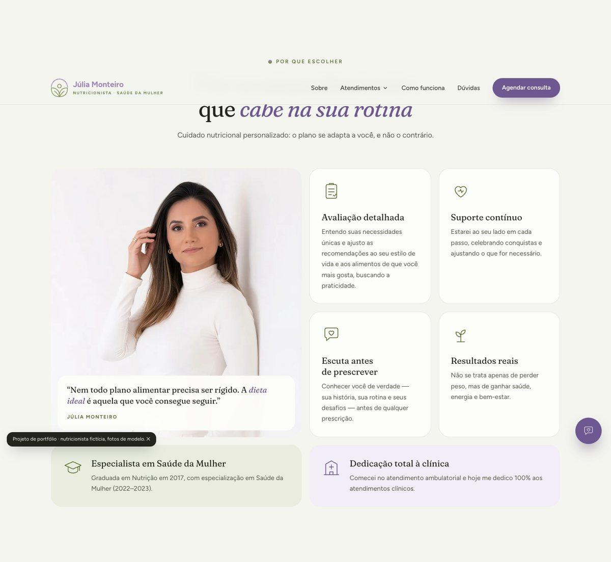
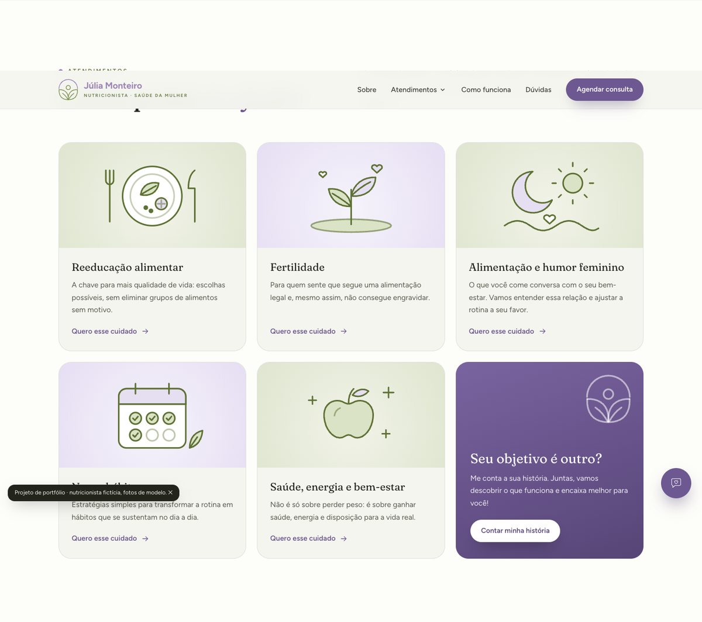
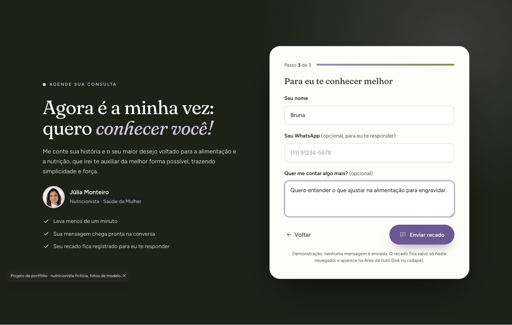
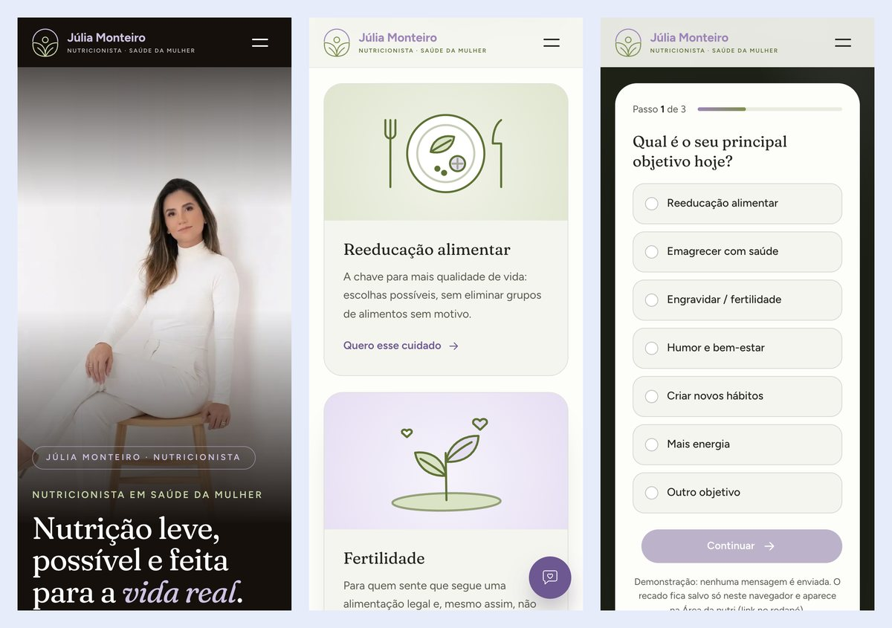
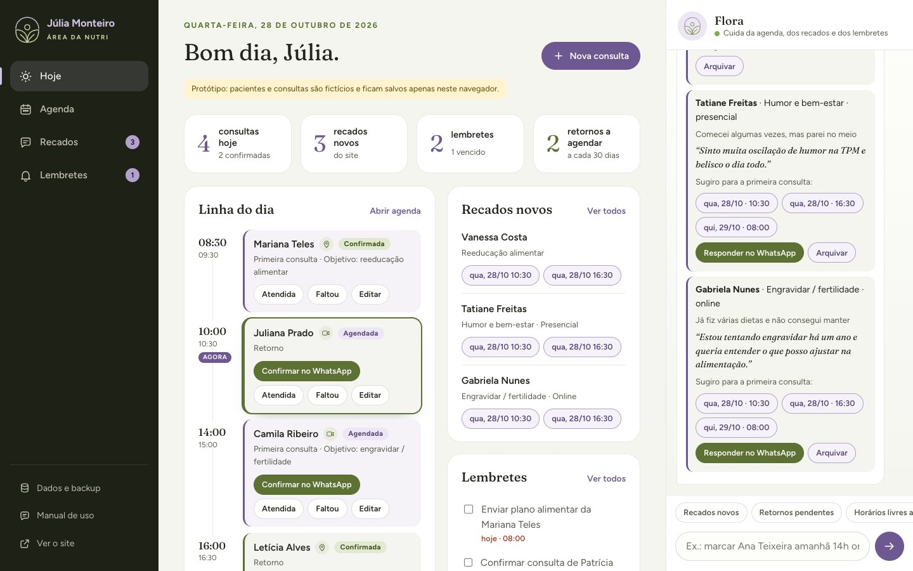
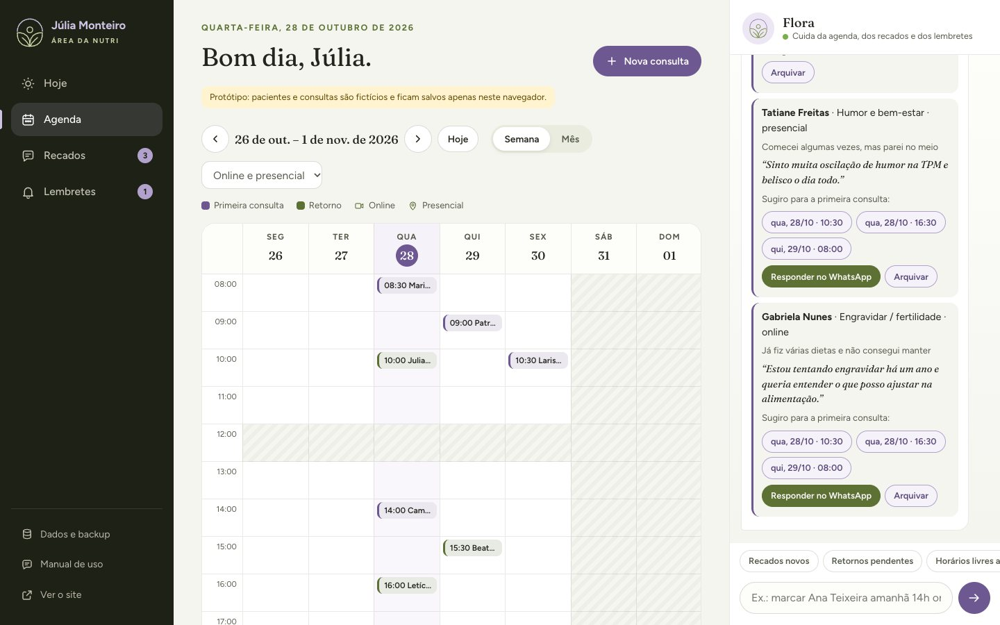
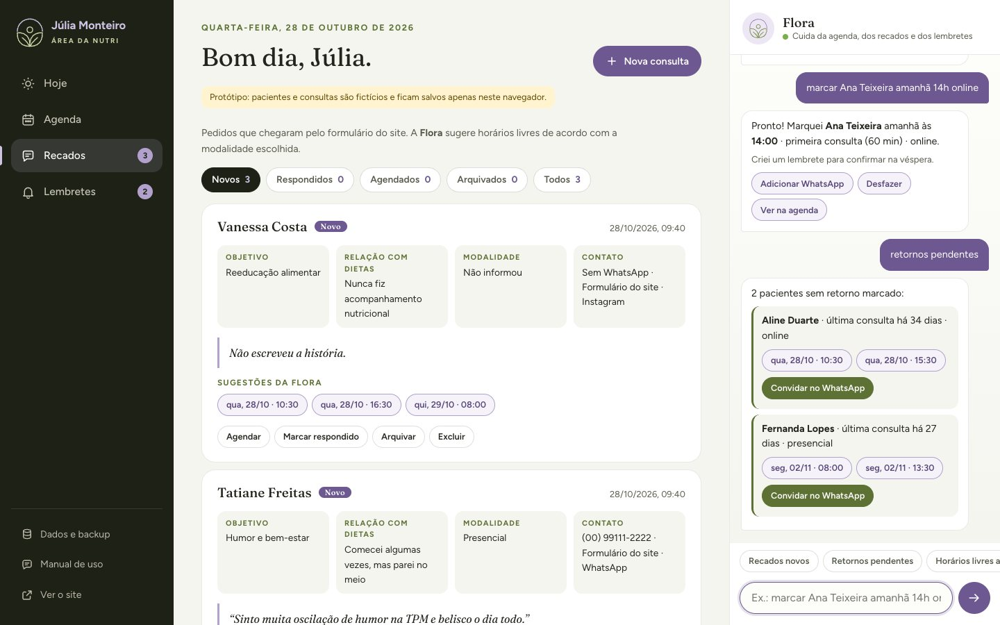
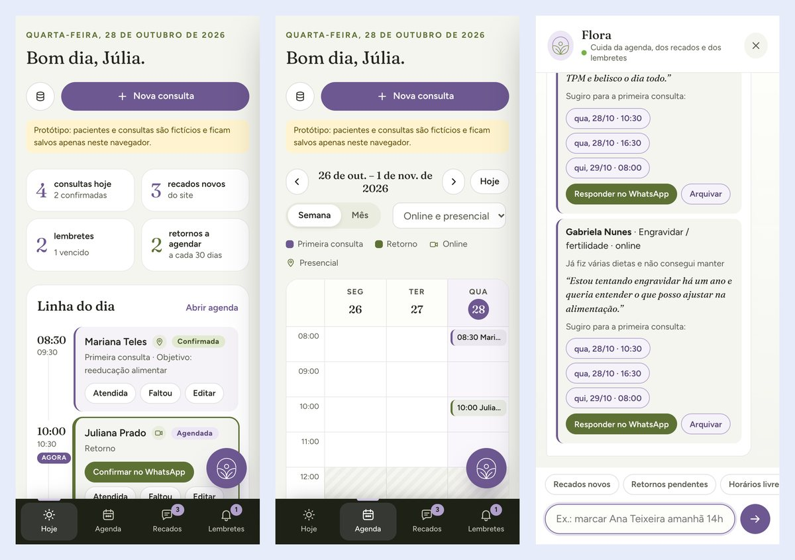

# Júlia Monteiro · Nutricionista: site + Área da nutri

Site de consultório para a nutricionista **Júlia Monteiro** (Saúde da Mulher, personagem fictícia), com formulário de agendamento em 3 passos, e uma **Área da nutri** (painel privado) com agenda, recados do site, lembretes, controle de retornos e uma assistente, a **Flora**, que entende pedidos escritos em português.

Feito em **HTML, CSS e JavaScript puros**, sem framework e sem etapa de build. Os dados ficam no `localStorage` do navegador, atrás de uma pequena interface de banco de dados que pode ser trocada por um banco real.

> **Versão de portfólio.** O projeto nasceu de um site feito para uma cliente real. Nesta versão, **a nutricionista é fictícia**: nome, formação, trajetória, curiosidades e contatos foram inventados, e não há Instagram, WhatsApp, CRN nem endereço. **As fotos são de uma modelo, apenas ilustrativas.** O site roda em **modo demonstração**: o formulário não envia mensagem a ninguém, só grava o recado na Área da nutri do próprio navegador. As pacientes da Área são fictícias.


## Sumário

- [O que tem](#o-que-tem)
- [Capturas de tela](#capturas-de-tela)
- [Arquitetura](#arquitetura)
- [Decisões técnicas](#decisões-técnicas)
- [Como rodar](#como-rodar)
- [Como as capturas foram feitas](#como-as-capturas-foram-feitas)
- [Limitações conhecidas](#limitações-conhecidas)
- [Próximos passos](#próximos-passos)

## O que tem

### Site (`index.html`)

- Topo em tela cheia, mosaico "por que escolher", cartões de atendimento, tabela "coisas que eu acredito × coisas que eu não acredito", sobre, passo a passo, onde atendo, perguntas frequentes e faixa final.
- **Formulário em 3 passos** (objetivo → relação com dietas → nome, WhatsApp opcional e modalidade). Os cartões de atendimento já marcam o objetivo e pulam para o passo 2.
- O destino do formulário depende do `config.js`:
  - com WhatsApp: abre a conversa com a mensagem pronta;
  - sem WhatsApp, com Instagram: copia a mensagem e abre o Direct;
  - **modo demonstração** (o deste repositório): não abre nada, só grava o recado.
  - Em todos os casos, o envio vira um **recado na Área da nutri**, e a nota do formulário diz isso.
- "Onde atendo" é montado a partir de `config.locais`: cartão de consulta online e um cartão com Google Maps por consultório.
- Dados que faltam (CRN, WhatsApp, cidade, endereços) somem sozinhos. Com `rascunho: true`, aparecem selos "a confirmar" para a cliente aprovar a prévia.
- Eventos de medição prontos para `dataLayer`, Meta Pixel e Google (`cta_agendar`, `atendimento_escolhido`, `quiz_passo`, `lead_formulario`), se forem instalados.
- Menu com submenu acessível por teclado, botão flutuante que some perto do formulário e do rodapé, animações de entrada que respeitam `prefers-reduced-motion`. No celular (375 px), sem rolagem lateral.

### Área da nutri (`painel.html`)

Três colunas no computador (menu | conteúdo | assistente). No celular, abas embaixo e a assistente abre por um botão redondo.

- **Hoje:** números do dia, linha do tempo das consultas com "Atendida / Faltou / Confirmar no WhatsApp", recados novos com horários sugeridos e lembretes do dia.
- **Agenda:** semana e mês, filtro online/presencial, cores por tipo de consulta e **detecção de conflito** que leva em conta a duração de cada tipo (primeira consulta 60 min, retorno 30 min).
- **Recados:** tudo o que chega pelo formulário do site, com filtros por situação, sugestões de horário e resposta pronta no WhatsApp.
- **Lembretes:** lembrete automático para confirmar na véspera, aviso na tela e notificação do navegador.
- **Retornos:** depois de "Atendida", a área oferece marcar o retorno (padrão de 30 dias) e lista quem está sem próxima consulta.
- **Dados e backup:** baixar e restaurar um `.json`, carregar dados de exemplo ou apagar tudo.
- **Flora, a assistente:** entende pedidos como "marcar Ana Teixeira amanhã 14h online", "retorno da Juliana daqui a 30 dias", "remarcar Camila para quinta 10h", "Letícia foi atendida", "retornos pendentes", "lembrar de enviar o plano da Mariana amanhã 9h" e "resumo da semana". Pergunta o que faltar, oferece **Desfazer** e prepara as mensagens de WhatsApp (quem envia é sempre a nutricionista).

> A Flora **não é inteligência artificial**. É um interpretador de linguagem **por regras**: expressões regulares para datas, horas, nomes e intenções, mais pequenos fluxos de pergunta e resposta. Roda inteiro no navegador e não envia dados a nenhum serviço. Trocar por um modelo de linguagem está no [roadmap](#próximos-passos).

### Manual de uso (`manual.html`)

Manual da Área para a nutricionista, em 12 capítulos, com capturas de tela e versão para imprimir ou salvar em PDF (A4, CSS de impressão).

## Capturas de tela

| Site | |
|---|---|
|  |  |
|  |  |

| Área da nutri | |
|---|---|
|  |  |
|  |  |

## Arquitetura

```
index.html          site
painel.html         Área da nutri
manual.html         manual de uso (tela e impressão)
css/style.css       estilos do site
css/painel.css      estilos da Área
js/config.js        TODOS os dados da cliente (nome, contatos, modalidades, agenda)
js/db.js            mini banco de dados (localStorage) + utilitários (U)
js/main.js          comportamento do site e do formulário
js/painel.js        regras da agenda e telas da Área
js/painel-ia.js     assistente por regras
assets/img/         fotos (WebP + JPG), símbolo, ícones e imagem de compartilhamento
assets/manual/      capturas usadas no manual
scripts/            geração das capturas e da imagem de compartilhamento (Playwright)
docs/capturas/      imagens deste README
```

Ordem de carregamento: `config.js` → `db.js` → `main.js` (site) ou `painel.js` → `painel-ia.js` (Área). Cada arquivo é uma IIFE que publica um objeto global pequeno; não há bundler nem módulos.

### `config.js`: uma cliente = um arquivo de dados

Nome, WhatsApp, Instagram, CRN, cidade, modalidades, consultórios, nome da assistente, grade de horários, duração de cada tipo de consulta, almoço e prazo de retorno ficam em `window.SITE`, junto com as chaves `rascunho` (prévia para aprovação) e `demo` (portfólio). O resto do código lê daqui.

### `db.js`: interface trocável

```js
DB.list(colecao)               // 'recados' | 'agenda' | 'lembretes'
DB.add(colecao, item)          // cria com id e data de criação
DB.update(colecao, id, patch)
DB.remove(colecao, id)
DB.exportar() / DB.importar(json) / DB.limpar()
DB.chave(nome)                 // chave com o prefixo 'nutri_'
```

Cada gravação dispara o evento `db:change`, e a Área se redesenha. Outra aba que grava (o site, por exemplo) dispara o evento `storage` do navegador, que a Área usa para avisar "chegou um recado novo". A ideia é que uma versão com banco real (Supabase, por exemplo) implemente **essas mesmas funções**, e o resto do código não precise mudar.

Tudo o que é lido do armazenamento ou de um backup importado é tratado como **não confiável**: chaves e tamanhos de texto limitados, ids só com caracteres seguros, situação e tipo validados contra listas fechadas, datas e horas por formato. Todo texto que vai para o HTML passa por `U.esc`.

### `painel.js`: regras da agenda

Publica `window.AG` (regras) e `window.PN` (ações da tela). As regras principais:

- `grade(data, tipo)`: horários de início possíveis num dia, respeitando dias de atendimento, expediente, almoço, passo da grade e duração do tipo.
- `ocupado(data, hora, tipo)`: conflito é **sobreposição de intervalos**, não horário igual (uma primeira consulta às 13h30 ocupa até 14h30).
- `livres` / `proximos`: horários livres no dia e próximas sugestões, filtrando manhã/tarde e o que já passou.
- `retornosPendentes()`: quem foi atendida há (prazo − 7) dias ou mais e não tem consulta futura.
- `criarConsulta()`: marca, liga ao recado de origem e cria o lembrete de confirmação na véspera.

### `painel-ia.js`: interpretador de linguagem por regras

1. **Normalização:** minúsculas e sem acentos (`U.norm`).
2. **Roteador:** uma sequência de expressões regulares identifica a intenção (marcar, remarcar, cancelar, confirmar, atendida, faltou, retornos, livres, lembrete, resumo, ajuda…). A ordem importa: "retornos pendentes" é testado antes de "retorno da Juliana…".
3. **Extração:** `parseData` entende "hoje", "amanhã", "depois de amanhã", dias da semana, "sexta que vem", "25/11", "dia 25", "daqui a 30 dias"; `parseHora` entende "14h", "14:30", "às 9", "3 da tarde"; `parseNome` tira o nome do resto da frase e `porNome` procura a paciente por **início de palavra** ("Ana" não encontra "Mariana").
4. **Fluxos:** se falta algo (nome, data ou hora), a assistente pergunta e guarda o estado da conversa; "cancelar" sai do fluxo.
5. **Ações nos balões:** botões de horário, Desfazer, Ver na agenda e links de WhatsApp são funções registradas na hora, sem `eval` e sem HTML vindo do usuário.

## Decisões técnicas

- **Sem framework e sem build.** O site precisa abrir rápido em celular modesto, ser publicado em qualquer hospedagem estática e ser mantido por uma pessoa só. ~3.800 linhas no total.
- **Configuração separada do código.** O mesmo código atende outra nutricionista trocando `config.js`; o projeto foi pensado como modelo para várias clientes.
- **Protótipo honesto.** Os dados ficam no navegador, a Área mostra um aviso disso, e o formulário diz que guarda um recado. Uma frase antiga do site ("Nada fica salvo neste site") deixou de ser verdade quando o formulário passou a gravar recados e foi corrigida.
- **Nenhum envio automático.** A Área e a assistente só **preparam** mensagens de WhatsApp (`wa.me` com texto); quem envia é a pessoa. Em modo demonstração, o formulário do site não abre WhatsApp nem Instagram.
- **Dados de exemplo seguros.** As pacientes fictícias usam o DDD 00, que não existe, para nenhum botão de WhatsApp abrir conversa com um número real.
- **Acessibilidade.** Marcação semântica, `fieldset`/`legend` no formulário, foco movido para a pergunta a cada passo, `aria-live` nas mensagens, abas com `role="tab"`, textos alternativos nas fotos, `prefers-reduced-motion`.
- **Imagens.** Fotos em WebP com JPG de reserva (`<picture>`), largura e altura declaradas (sem pulo de layout) e `loading="lazy"` fora do topo. Ícones e ilustrações dos atendimentos em SVG num sprite (`<symbol>` + `<use>`), com as cores do símbolo da marca vindas de variáveis CSS.
- **Cache.** CSS e JS têm `?v=` na URL; ao mudar um arquivo, sobe o número.

## Como rodar

Precisa só de um servidor estático.

```bash
python3 -m http.server 5220
```

Depois abra:

- site: http://localhost:5220
- Área da nutri: http://localhost:5220/painel.html (link "Área da nutri" no rodapé)
- manual: http://localhost:5220/manual.html

Na primeira visita, a Área carrega pacientes de exemplo. Para ver o fluxo completo, preencha o formulário do site e abra a Área no mesmo navegador: o recado aparece em **Recados** e a Flora avisa.

Para usar de verdade, preencha `js/config.js` (WhatsApp, CRN, cidade, modalidades, consultórios) e troque `demo` para `false`.

## Como as capturas foram feitas

As imagens do README e do manual são geradas por script, com **Playwright 1.58** (o do `python3` do sistema) controlando o **Brave em modo headless**. O relógio da página é fixado com `page.clock.set_fixed_time` (quarta-feira, 28/10/2026, 9h40), então a agenda, as saudações e as sugestões de horário saem sempre iguais.

```bash
python3 scripts/capturas.py            # README (docs/capturas) e manual (assets/manual)
python3 scripts/imagens-marca.py       # imagem de compartilhamento (og.jpg)
```

O script sobe um servidor próprio numa porta livre, desliga animações, força o carregamento das imagens preguiçosas, recorta as partes usadas no manual e atualiza `width`/`height` das imagens no `manual.html`. Para usar o Chromium do Playwright em vez do Brave, troque `NAVEGADOR` por `None` em `scripts/capturas.py`. Requer também o Pillow.

## Limitações conhecidas

- **Sem login.** A Área abre para quem tiver o link (tem `noindex`, mas isso não é proteção).
- **Dados só no navegador.** O recado do site só chega à Área se for o mesmo navegador; trocar de computador exige backup e restauração.
- **Assistente por regras.** Entende bem os padrões previstos, mas não frases muito livres.
- **Sem testes automatizados.** O projeto foi validado manualmente e com scripts de captura (sem erros no console, sem rolagem lateral em 375 px).
- **Textos no HTML.** Os dados da cliente estão no `config.js`, mas os textos das seções ainda estão no `index.html`.

## Próximos passos

1. **Supabase com login e RLS.** Implementar a interface do `db.js` sobre o Supabase: tabelas `recados`, `consultas` e `lembretes`; login por e-mail para a nutricionista; políticas de Row Level Security em que só a dona lê e altera os dados; o formulário público só **insere** recados (via função com validação e limite de envios). Dados de pacientes são dados de saúde (LGPD), então o acesso precisa ser restrito desde o início.
2. **Assistente com modelo de linguagem e chamada de ferramentas.** Manter as funções de `AG` como ferramentas (`horarios_livres`, `marcar_consulta`, `remarcar`, `cancelar`, `criar_lembrete`, `retornos_pendentes`) e deixar um modelo de linguagem interpretar o pedido e escolher a ferramenta, por um servidor (a chave nunca fica no navegador). As regras de conflito e de horário continuam no código, e a confirmação da pessoa continua obrigatória antes de gravar.
3. **Testes.** Testes de unidade para `parseData`, `parseHora`, `parseNome`, `grade`, `ocupado` e `retornosPendentes` (com data fixa), e testes de ponta a ponta com Playwright para o fluxo site → recado → consulta marcada.
4. **Gerador por arquivo de dados.** Levar também os textos, as cores e as fontes para um arquivo de dados por cliente e gerar o site a partir dele, para criar uma nova versão sem editar HTML.
